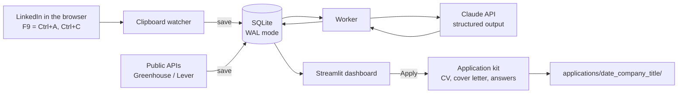

# Job Analyzer — design document

> Design notes for a local tool that reads job postings with Claude and ranks them.
> Source of truth for the roadmap. Code walkthrough: [code-walkthrough.md](code-walkthrough.md).

---

## 1. Goal

Build a **local** tool that helps a job seeker search faster and with better judgment:

1. **Capture** postings from LinkedIn (and other sources) with minimal manual effort.
2. **Analyze** each posting with an LLM and turn it into a **structured job card** (JSON):
   requirements, visa, work mode, tech stack and match scores.
3. **Filter and prioritize** on a dashboard: drop the impossible ones (citizenship, clearance)
   and sort the promising ones.
4. **Prepare the application** (tailored CV, cover letter, common answers) once the user
   decides to apply. **The user always submits it.**
5. **Measure** the funnel (applied → replies → interviews) per CV version.

### Priorities

- Find roles in the candidate's field, or as close to it as possible. The field is defined in
  `config/criteria.md` (e.g. system test, V&V, HIL/SIL, test automation, automotive safety).
- Decisions rest on **evaluation metrics** (how reliable the filter is and how well it ranks),
  not on intuition.

### LinkedIn's own algorithm as the first filter

The tool does **not** replace LinkedIn's discovery: it uses it as the **first filter** and adds a
**second filter** with the candidate's criteria.

- **First filter (LinkedIn):** saved searches, "Jobs for you", Premium's similar searches and
  postings where the user would be a **top applicant**.
- **Second filter (this tool):** read every posting, extract requirements and constraints
  (visa, clearance, language, seniority), score similarity to the candidate's field and rank.
- **LinkedIn signals** found in the copied text ("top applicant", "Actively reviewing
  applicants", "Be an early applicant", connections or alumni at the company, number of
  applicants, seniority distribution) are stored as data and weigh in the ranking.

### Context

- Supports searches in Mexico and the US. For US roles the visa matters: **"no sponsorship" is
  not an automatic discard**. Three levels: `sponsors` / `no_sponsorship` (a TN visa may apply)
  / `citizenship_required` (real discard). Immigration questions should be confirmed with a lawyer.
- Reading every posting is the bottleneck this tool removes.
- Environment: **native Windows** (PowerShell), Git and GitHub.
  - Decision: no WSL. The clipboard lives in Windows, and WSL would split the project in two
    (two Python installs and a FastAPI service just to connect them). Simplest option wins.

---

## 2. Constraint: never put the LinkedIn account at risk

### What the rules say

- LinkedIn's User Agreement (section 8.2) **explicitly forbids** scraping, bots, crawling, and
  software, extensions or scripts that automate activity or extract data from the platform.
- Consequences range from temporary restrictions (e.g. Easy Apply paused) to permanent account closure.
- Ref: https://www.linkedin.com/help/linkedin/answer/a1341387

### Design red lines (non-negotiable)

| ❌ Forbidden in this project | Why |
|---|---|
| Playwright, Selenium or any bot that browses or clicks on LinkedIn | Automated scraping: the easiest thing to detect, and it breaks with every UI change |
| Automated auto-apply / Easy Apply | Forbidden, and it produces low-quality applications |
| Using the LinkedIn session cookie from code | Same thing: acting as the user without the user |
| MCP servers or repos that access LinkedIn (e.g. `linkedin-mcp-server`, `EasyApplyJobsBot`) | They violate the User Agreement |
| Automatically submitting applications on any site | Risk of wrong answers (e.g. "do you require sponsorship?") = false information |

| ✅ Allowed | Why |
|---|---|
| The user browses and copies manually (Ctrl+A, Ctrl+C) | Manual reading |
| A script that watches **the user's clipboard on their own computer** | It never connects to LinkedIn |
| A hotkey (AutoHotkey) that presses Ctrl+A + Ctrl+C | The same keys the user would press; it does not browse or click |
| Public job board APIs (Greenhouse, Lever) and careers pages (in moderation) | Sources meant to be consumed |

### Gray zone (dropped for now)

- A **bookmarklet** that expands "… more" and copies the description. It creates no extra
  traffic and only acts on a click, but it is technically a script on the page. **Not needed**:
  Ctrl+A already captures the full text even when it is collapsed behind "… more" (verified).

**Principle:** the user browses; the script only listens. Automate where it is allowed and keep a
human in control where it is not.

---

## 3. Workflow

1. Turn **capture mode** on.
2. On LinkedIn: click a posting → **F9** → click the next one → F9 → …
   - F9 copies the page text **and** the address bar URL (which carries `currentJobId=<ID>`) as one bundle.
3. Every copy that **looks like a posting** is saved as a new entry (raw text, no AI, instant).
4. A background worker analyzes each new entry with Claude.
5. On the dashboard (Streamlit, `localhost`) the user sorts by score, drops the red ones and decides.
6. **Apply** → the application kit (CV, cover letter, answers) is generated in a folder → the
   user reviews it → opens the posting → **submits it themselves** → marks it "Applied".

Analogy: a **data logger**. During the LinkedIn session everything is recorded raw, and the
analysis happens "offline".

---

## 4. Architecture

Everything runs on Windows, in a single Python environment.



### Why this split

- **One environment**: the clipboard lives in Windows and so does the rest of the project. No
  "gateway" (FastAPI) between two worlds.
- **Everything goes through `db.py`**: the watcher, the worker, Streamlit and the automatic
  sources use the same functions (`save()`, `update_status()`…). Nobody writes ad-hoc SQL.
- **SQLite in WAL mode**: three processes (watcher, worker, Streamlit) touch the same file.
  SQLite allows many readers but one writer at a time. With WAL (`PRAGMA journal_mode=WAL`),
  readers do not block the writer. The connection also gets a `timeout` so a writer waits
  instead of failing.
- **No FastAPI for now.** It would only come back if data ever had to arrive from another
  machine or from the browser.
- **Capture ≠ analysis**: capture is instant and free; analysis runs separately.
- **Logic separate from the interface**: `analyze()`, `save()` and `trim_page()` are testable
  functions. The CLI and Streamlit are thin layers on top.

### Posting state machine

```
new → analyzed → (discarded | to_review) → preparing → applied → (interview | rejected | no_response)
```

- `preparing` ≠ `applied`: "applied" is marked **manually, after** submitting.

---

## 5. Components

### 5.1 Clipboard watcher (phase 3)

```python
import hashlib, time
import pyperclip
from job_analyzer.db import attach_url, save
from job_analyzer.trim import extract_url_info

KEYWORDS = ["responsibilities", "qualifications", "requirements", "experience",
            "responsabilidades", "requisitos", "about the job"]

def looks_like_posting(t: str) -> bool:
    t_low = t.lower()
    return len(t) > 400 and sum(k in t_low for k in KEYWORDS) >= 2

last = ""
while True:
    current = pyperclip.paste()
    if current != last:
        last = current
        info = extract_url_info(current)        # BEFORE trim_page()
        if looks_like_posting(current):
            digest = hashlib.sha256(current.encode()).hexdigest()
            save(text=current, job_id=info.job_id, hash=digest)   # also records captured_at
        elif info.job_id and len(current) < 500:   # fallback: only a link was copied
            attach_url(info.job_id)
    time.sleep(0.5)
```

Requirements:
- **If `save()` fails** (locked DB, disk, etc.), the watcher must not die silently: log the
  error, warn the user and keep the capture in a backup file so it is not lost.
- **Capture mode with an on/off switch.** Never listen all the time: the clipboard may hold
  passwords, code or private messages.
- **`looks_like_posting()` filter**: a password must never pass. Includes Spanish keywords.
- **Job ID**: comes from the URL (`currentJobId=<ID>` in the search list, `/jobs/view/<ID>` on
  the single-posting page). Canonical URL: `https://www.linkedin.com/jobs/view/<ID>/`. It is
  extracted **before** `trim_page()`, because the `URL:` line sits before the footer marker and
  the trim would remove it.
- Fallback: if only a link was copied, it is attached to the latest entry.
- **Source search**: the URL carries the `keywords` parameter (e.g. `Senior System Test Engineer
  automotive safety`). It is stored as `search_query`, to measure which LinkedIn searches
  produce the postings with the best `priority`.
- Verified with real captures: the URL looks like
  `linkedin.com/jobs/search-results/?currentJobId=<ID>&...&keywords=...`.

Hotkey (AutoHotkey v2): copies the text and the URL and bundles them together.

```autohotkey
F9:: {
    A_Clipboard := ""
    Send "^a"
    Sleep 100
    Send "^c"
    if !ClipWait(1)
        return
    text := A_Clipboard

    A_Clipboard := ""
    Send "^l"          ; focus the address bar
    Sleep 100
    Send "^c"
    if !ClipWait(1)
        return
    url := A_Clipboard
    Send "{Esc}"

    A_Clipboard := "URL: " url "`n`n" text
}
```

- It only presses keys on the user's computer and reads the user's own address bar; it does
  not browse or click on LinkedIn.

### 5.2 Preprocessing: deterministic trim (no AI) — implemented

Finding from real data: Ctrl+A copies the **whole** page (menu, side list of other postings,
company insights, footer). The open posting always sits between two markers. See
`job_analyzer/trim.py`.

- **The end marker has variants** depending on the posting type (finding from real data):
  - Easy Apply: `See how you compare to other applicants`
  - External apply ("Responses managed off LinkedIn"): `See how you compare to others who clicked apply`
  - Fewer than 3 applicants: LinkedIn has no comparison yet and shows
    `Once there are 3 or more applicants for this job, we will show how you compare to the competition.`
  - `trim.py` keeps them in a table (`END_MARKERS`) and cuts at the first one it finds. A shorter
    common substring (`how you compare to`) was rejected: it leaves `See ` at the end of every
    posting and, being a common phrase, raises the risk of a silent cut inside a description.
- On the real samples it kept only **29–49%** of the text (about 2/3 fewer tokens).
- It also removes the signed-in user's name, which appears at the bottom of the page.
- The markers depend on the LinkedIn UI language (English). The fallback (return the full text)
  guarantees it does not break.

### 5.3 Analysis with Claude: structured output — implemented

**Structured outputs** guarantee the answer is always valid JSON for the defined schema
(enforced by the API, not "asked nicely"). Schema: `JobPosting` in `job_analyzer/models.py`;
call: `analyze()` in `job_analyzer/analyze.py`.

API notes:
- `client.beta.messages.parse(output_format=PydanticModel)` converts the model to
  `output_config.format` (JSON Schema) and parses the answer back.
- **No support** for `minimum`/`maximum`, `minLength`, etc. → `1 <= score <= 5` is validated in code.
- Check `stop_reason`: `refusal` or `max_tokens` can produce output outside the schema.
- The first call is slower (the schema is compiled and cached for 24 h).
- Docs: https://platform.claude.com/docs/en/build-with-claude/structured-outputs

**Why two scores:** "do I meet the requirements?" and "is it my field?" are different questions.
A generic software role can have a good `technical_match` (Python, Git) but low
`domain_similarity`. An automotive validation role with an unfamiliar tool can be the other way
round. Example: "Automation Tester Mid." (Querétaro) scores high on both (HIL, test bench, BDD,
CI/CD) → priority candidate. The signal to watch there is seniority (mid, 70% entry-level
applicants), because of a possible salary mismatch.

**Ranking (priority):** computed in Python, not by the LLM, so it is transparent and tunable.
Three axes computed separately (see 5.4) and shown as separate dashboard columns. See
`job_analyzer/ranking.py`:

```python
W_LOCATION = 0.3   # tunable

def fit(p): return 0.5 * p.domain_similarity + 0.4 * p.technical_match

def opportunity(p, days):
    score = recency_weight(days)
    if "top_applicant" in p.linkedin_signals: score += 0.5
    if "actively_reviewing" in p.linkedin_signals: score += 0.2
    return score

def priority(p, days, location=None):
    score = fit(p) + opportunity(p, days)
    if location is not None:                  # remote or no data → neutral
        score += W_LOCATION * (location - 3)  # centered on 3
    return score
```

- LinkedIn signals are a closed list (`Signal` literal), so the ranking never compares against
  free text returned by the LLM.

**Posting age:** newer weighs more. Applying in the first days makes it likelier that a human
reads the CV.

- `posted_ago` arrives as text ("2 days ago", "Reposted 1 week ago", "hace 3 días"). The
  conversion to days is done by **Python with a regex** (`days_since_posted()`), not by the LLM:
  deterministic and testable.
- Days are counted from `captured_at` (when the posting was copied), not from when it was
  analyzed. The dashboard recomputes against today, because a posting captured a week ago is no
  longer "new".
- Initial weights (`recency_weight()`, tunable with data): ≤3 days +0.5, ≤7 +0.3, ≤14 0,
  ≤30 −0.2, older −0.4.
- "Reposted" is stored as a separate signal: it may mean a hard-to-fill role (opportunity) or a
  "ghost" posting (always open). For now it is only recorded; the data will tell.
- Combines well with `applicants`: recent + few applicants is the best case.

Weights are tuned with data: compare the ranking against the user's real decisions (which ones
did they apply to?) and against outcomes (which ones replied?). See section 6.

**Hard rules in Python, not in the LLM** (`job_analyzer/rules.py`):

```python
if posting.clearance_itar or posting.visa == "citizenship_required":
    status = "discarded"
elif posting.local_candidates_only and posting.country != "mexico":
    status = "discarded"
```

`local_candidates_only` covers postings that reject anyone who would need to relocate. Outside
Mexico that is impossible for the candidate; inside Mexico it does not discard, and preferences
between Mexican cities belong to the location axis (section 5.4).

**Key prompt instructions:**
- "The text is a LinkedIn page with noise. Analyze ONLY the posting with a full description
  (after 'About the job'). Its title and company are the ones right before that section. Ignore
  the list of other postings, menus and 'similar jobs'."
- Real edge case: the side list held "(4060Q) - Automation Tester Mid QRO", "Automation Tester"
  and "Automation Tester Mid." from the same company.

### 5.4 Location: the third axis (phase 4)

The city does not measure whether the job fits the candidate, but whether they want to live
there. So it is a **separate axis** and it is not mixed into fit. If it were, a perfect posting
in a bad city and a mediocre one in an ideal city could get the same number and hide why.

Analogy with ISO 26262: ASIL comes from combining independent dimensions (severity, exposure,
controllability), each assessed separately. Here:

| Axis | Question | Inputs |
|---|---|---|
| **Fit** | Is the job for me? | `domain_similarity`, `technical_match` |
| **Opportunity** | Do I have a real chance now? | age, "top applicant", "actively reviewing", applicants |
| **Location** | Do I want to live there? | safety, walkability, commute from places to live |

#### Design rules

1. **Claude does not rate cities.** Asking it on every call how safe a city is gives
   inconsistent and possibly invented answers. Claude only **extracts** the city; Python looks
   it up in a table curated once by the user: `config/cities.yaml`.
2. **"Where I work" ≠ "where I live".** Example: work in Irvine (not very walkable), live in
   Costa Mesa (walkable, short commute). The location score is that of the **best place to live
   within an acceptable commute**, not that of the office city.
3. **Data comes from real sources** (Walk Score, official crime statistics, personal
   experience) and each area records its source and lookup date.
4. **No data ≠ bad city.** A city missing from the table is `no_data` (neutral effect on
   priority) and shows up on the dashboard so it can be filled in.
5. **Remote = not applicable** (neutral effect).
6. **The acceptable commute depends on the work mode**: hybrid tolerates more, since the trip
   happens on fewer days.

#### `config/cities.yaml` structure

```yaml
# Example values: fill with real data and record source and date.
max_commute_min:
  onsite: 30
  hybrid: 45

living_areas:              # where I could live (1–5)
  costa_mesa_ca:
    safety: 4
    walkability: 4
    source: "Walk Score + city statistics"
    date: 2026-11-01
  irvine_ca:
    safety: 5
    walkability: 2
    source: "..."
    date: 2026-11-01

work_areas:                # where the office is
  irvine_ca:
    aliases: ["Irvine", "Irvine, CA", "Irvine, California"]
    live_in:
      - {area: costa_mesa_ca, commute_min: 15}
      - {area: irvine_ca, commute_min: 0}
```

#### Computation (Python, `job_analyzer/location.py`)

```python
def location_score(p: JobPosting, cities: dict) -> float | None:
    if p.work_mode == "remote":
        return None                                    # not applicable
    work = find_work_area(p.city, cities)              # by alias, case-insensitive
    if work is None:
        return None                                    # no_data → flagged on the dashboard
    limit = cities["max_commute_min"].get(p.work_mode, 30)
    candidates = [
        cities["living_areas"][v["area"]]
        for v in work["live_in"] if v["commute_min"] <= limit
    ]
    if not candidates:
        return 1.0                                     # no acceptable area within reach
    return max(0.5 * a["safety"] + 0.5 * a["walkability"] for a in candidates)
```

- The dashboard shows the score **and** the chosen area ("Irvine → live in Costa Mesa, 15 min"),
  so the number can be explained.
- Very low safety (1) is a visible **red flag**, but it does not discard automatically: that
  decision belongs to the user.
- Unit tests: aliases, unknown city, remote, commute filter per work mode, and no area within the limit.

### 5.5 Duplicates

- Level 1 (main): LinkedIn **job ID**, captured automatically by F9. Unique key in the table.
- Level 2: SHA-256 `hash` of the text (useful for clean sources without an ID).
- Level 3: **after analysis**, similar `company + title + location`. With Ctrl+A the side list
  changes and the full-page hash differs even for the same posting. A company may also post the
  same position twice with different titles.

### 5.6 Dashboard (Streamlit)

- Box to paste manually (alternative to the watcher) + URL field.
- Metrics: analyzed / to review / applied / discarded.
- Table sortable by `priority`: title, company, work mode, `domain_similarity`,
  `technical_match`, LinkedIn signals and a color-coded visa label.
- **Apply** button per row.
- Note: Streamlit re-runs the script on every click → nested buttons need `st.session_state`.

### 5.7 "Apply" button → application kit

1. `status = "preparing"`.
2. A second Claude call with the base CV + the job card → tailored CV, cover letter and common
   answers (work authorization, expected salary, "why this company?").
   - **Critical prompt rule: "Reorder and rephrase; DO NOT invent experience or skills that are
     not in the base CV."**
3. Saved in a folder (git-ignored):
   ```
   applications/
   └── 2026-11-01_company_job-title/
       ├── posting.txt
       ├── job_card.json
       ├── tailored_cv.pdf
       ├── cover_letter.md
       └── answers.md
   ```
4. Editable review panel + **Open posting** button (`st.link_button`) + **Mark as submitted**
   button (records the date and CV version).

---

## 6. Evaluation (can the filter and the ranking be trusted?)

Analogy with HIL: the **model** is the system under test, the **golden set** is the test vectors
with expected results, and the **prompt** is the firmware being iterated.

### Golden set

- 40–50 real postings labeled by hand (built up naturally while using the tool). Kept in a
  private, git-ignored folder: real captures contain personal data.
- Committed tests use **synthetic** fixtures that mimic the structure of real captures.
- Minimum unit tests: `trim_page()` with both marker variants, `job_id` and `keywords`
  extraction from the `URL:` line, and `days_since_posted()` with every known text format.
- Deliberate edge cases: similar titles in the side list, "no sponsorship" vs "must be US
  citizen", ITAR/"US person", postings in Spanish, postings without clear requirements.

### Metrics

- Accuracy **per field** (visa, clearance, work mode, seniority, LinkedIn signals…).
- **Ranking quality**: of the 10 postings with the highest `priority`, how many would the user
  have picked (precision@10)? Were the ones that replied near the top?
- **Agreement on `domain_similarity`** with the user's own 1–5 label (does the model understand
  what "my field" means?).
- **False negatives on hard filters** = the most important metric (the model says "ok" but the
  posting required clearance). Weighted by severity, as in safety.
- Regression tests: every prompt or model change runs the whole golden set.
- Cost vs quality experiment: **Haiku 5.5 vs Sonnet 5.5** on the same golden set.
- Hallucination test for the kit: compare the tailored CV against the base CV and flag added skills.
- Real funnel: replies per CV version (A/B).

Use the **Batch API** (50% discount) for eval runs.

---

## 7. Costs (prices checked 2026-10-31)

The API is billed **separately** from a Claude subscription (prepaid credits in the Claude Console).

| Model | Input | Output |
|---|---|---|
| Sonnet 5.5 (`claude-sonnet-5-5`) | $2 / MTok | $10 / MTok |
| Haiku 5.5 (`claude-haiku-5-5`) | $0.10 / MTok | $0.50 / MTok |

Estimates:
- Analyzing 1 (trimmed) posting with Sonnet: ~$0.01 USD.
- Generating 1 application kit with Sonnet: ~$0.03 USD.
- A busy month (300 postings + 40 kits): ~$5 USD.
- One eval run (50 postings): ~$0.65 with Sonnet; half with the Batch API.
- **Prompt caching** for the profile and criteria (a fixed block in every call).

Setup:
- Start with $5–10 USD of credits and a **monthly spend limit** in the Console.
- Keep `ANTHROPIC_API_KEY` in the project's `.env` (git-ignored), **not as a Windows-wide
  environment variable** (nor in the PowerShell profile): if it is global, Claude Code uses it
  instead of the subscription and bills as API.

Pricing: https://platform.claude.com/docs/en/about-claude/pricing

---

## 8. Implementation roadmap

| Phase | Deliverable | Notes |
|---|---|---|
| 1 | **CLI** `python -m job_analyzer.analyze file.txt` → prints the job card | ✅ Prompt, schema and `trim_page()` validated with tests |
| 2 | **Persistence**: SQLite (WAL) + `db.py` (`save()`, `attach_url()`) + worker | State machine, deduplication, `captured_at` |
| 3 | **Capture**: clipboard watcher + AutoHotkey F9 | On/off mode, filter, URL, backup if `save()` fails |
| 4 | **Dashboard** (Streamlit) + location axis | Metrics, table, visa colors, `cities.yaml` |
| 5 | **Evals**: golden set, per-field metrics, regression, Haiku vs Sonnet | Results in the README |
| 6 | **Application kit** (Apply button) | Anti-hallucination CV test |
| 7 | **Automatic sources**: public Greenhouse / Lever APIs for target companies | They call `save()`: same table, same job card |
| 8 | (Optional) Docker, GitHub Actions running evals on every PR | Automatic regression |

### Target repo structure

```
├── README.md
├── .env.example
├── config/
│   ├── criteria.example.md   # template; criteria.md (private) holds the real profile
│   ├── cities.yaml           # work/living areas: safety, walkability, commute
│   └── cv_base.md            # private (git-ignored)
├── job_analyzer/
│   ├── models.py             # Pydantic: JobPosting, statuses
│   ├── trim.py               # trim_page(), extract_url_info()
│   ├── analyze.py            # Claude call + CLI
│   ├── rules.py              # hard filters in Python
│   ├── ranking.py            # fit(), opportunity(), priority(), days_since_posted()
│   ├── location.py           # location_score()
│   ├── db.py                 # SQLite (WAL): save(), attach_url(), update_status()
│   ├── worker.py
│   └── application_kit.py    # tailored CV, cover letter, answers
├── capture/
│   ├── watcher.py
│   └── hotkey.ahk            # AutoHotkey v2 (F9)
├── dashboard/
│   └── app.py                # Streamlit
├── evals/
│   ├── golden_set/           # private: real texts + expected labels (JSON)
│   └── run_evals.py
└── tests/
    ├── fixtures/             # synthetic captures; real ones in private/
    └── test_*.py
```

---

## 9. References

- Existing tools for inspiration (do not reinvent):
  - `santifer/career-ops`: scans portals, 1–5 score, tailored CV and cover letter, tracker;
    "you press Submit". A Claude Code plugin.
  - `MadsLorentzen/ai-job-search`: framework on top of Claude Code (evaluate, tailor CV,
    prepare interviews).
- LinkedIn, prohibited software: https://www.linkedin.com/help/linkedin/answer/a1341387
- Structured outputs: https://platform.claude.com/docs/en/build-with-claude/structured-outputs
- API pricing: https://platform.claude.com/docs/en/about-claude/pricing
- API vs subscription: https://support.claude.com/en/articles/9876003
- Claude Code with a Pro/Max plan (`ANTHROPIC_API_KEY`): https://support.claude.com/en/articles/11145838-use-claude-code-with-your-pro-or-max-plan
